<a href="https://github.com/Brainstorm2605"></a>

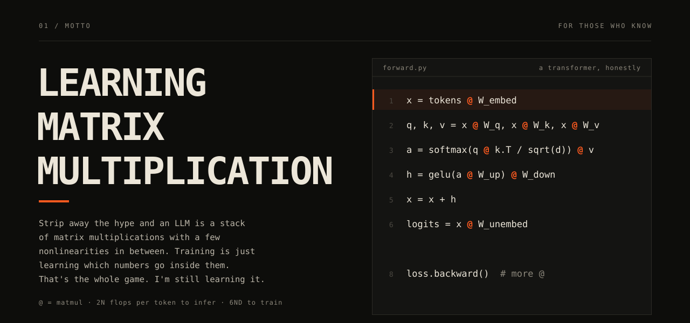

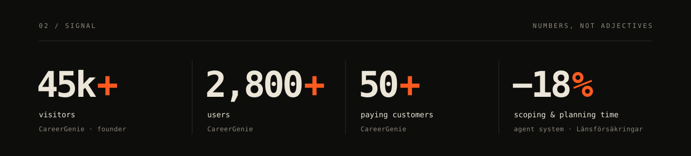


<a href="https://www.lynecode.com/"></a>

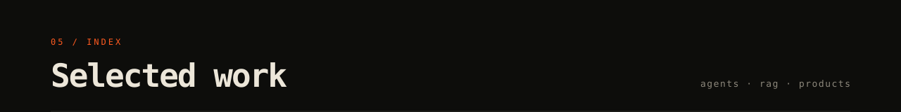
<a href="https://www.trycareergenie.com">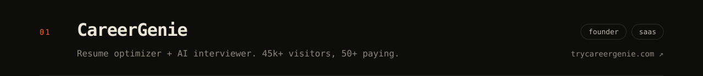</a>
<a href="https://github.com/Brainstorm2605/AI_Research_Agent">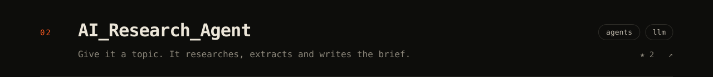</a>
<a href="https://github.com/Brainstorm2605/Resume_Checker">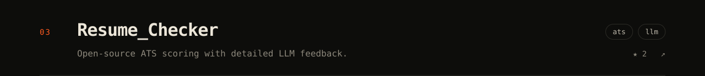</a>
<a href="https://github.com/Brainstorm2605/AI-interviewer">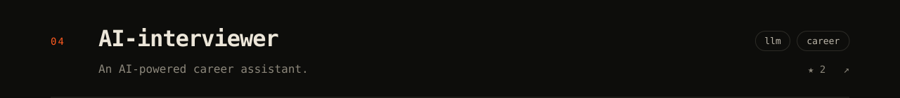</a>
<a href="https://github.com/Brainstorm2605/FAQ_RAG">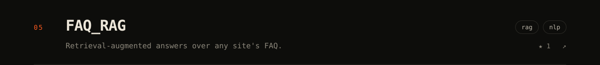</a>
<a href="https://github.com/Brainstorm2605/LLM_WEBSCRAPER">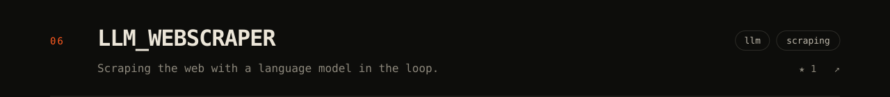</a>

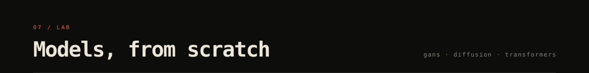
<a href="https://www.kaggle.com/code/mdzaidanwar/gpt-model">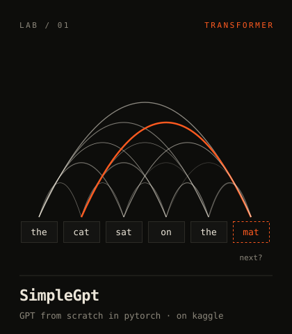</a>
<a href="https://github.com/Brainstorm2605/Simple-Diffusion">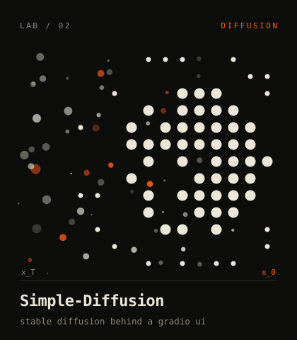</a>
<a href="https://github.com/Brainstorm2605/Pix2Pix">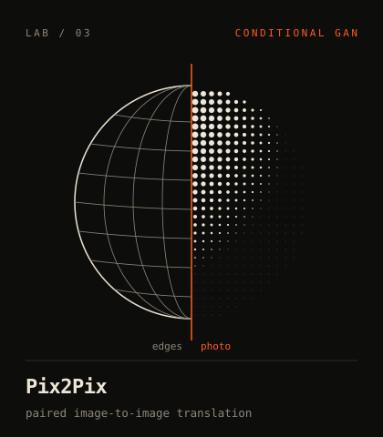</a>
<a href="https://github.com/Brainstorm2605/Cycle_GAN-s">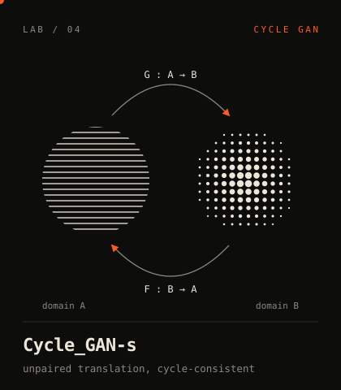</a>
<a href="https://github.com/Brainstorm2605/Simple_WGAN">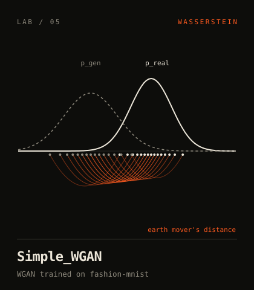</a>
<a href="https://github.com/Brainstorm2605/Photo-Restoration">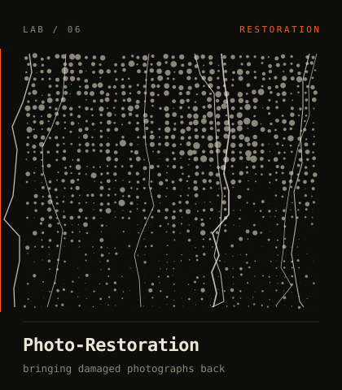</a>

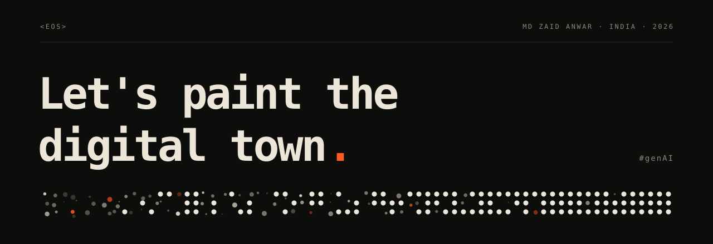

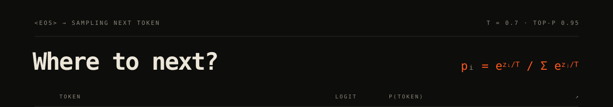
<a href="https://www.lynecode.com/"></a>
<a href="https://www.trycareergenie.com"></a>
<a href="https://www.kaggle.com/code/mdzaidanwar"></a>
<a href="https://www.linkedin.com/in/md-zaid-anwar-90a434182"></a>
<a href="https://pypi.org/project/lynecode/"></a>
<a href="mailto:zaidanwar26@gmail.com"></a>
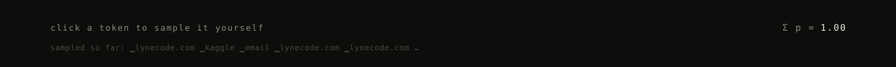
